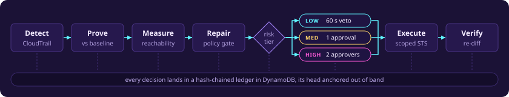
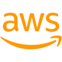
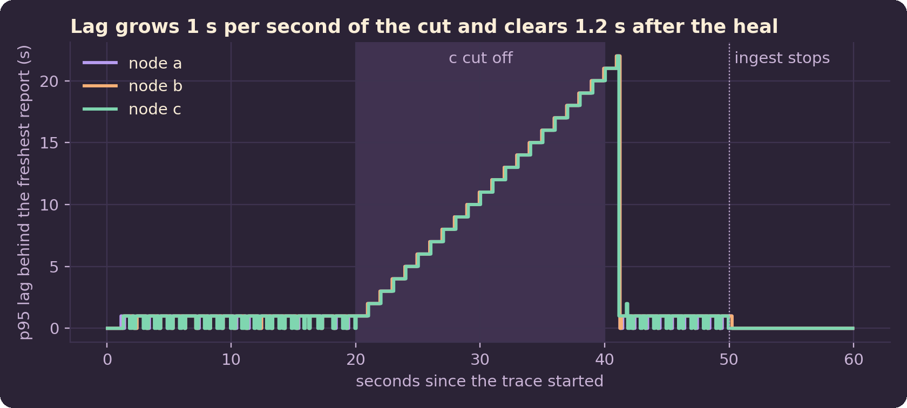
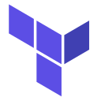
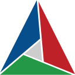
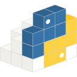
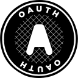

**CS student building cloud and distributed systems, and measuring them honestly.** 
Looking for a 2027 software engineering internship.

## What I do

I build systems end to end, deploy them on AWS, test them, and write down what the numbers actually say. The numbers on this page come from test runs, live measurements and merged PRs.

<picture>
  <source media="(prefers-color-scheme: dark)" srcset="https://skillicons.dev/icons?i=py%2Cgo%2Cc%2Cts%2Caws%2Cdynamodb%2Cterraform%2Cdocker%2Cgithubactions%2Clinux%2Cbash&theme=dark">
  
</picture>

Python daily. AWS SAM, Step Functions, Lambda, DynamoDB and IAM. Go for distributed systems, C when speed matters. Terraform, Docker and GitHub Actions to ship it.

##  Featured

### [Agentic NetOps](https://github.com/haeganm/agentic-netops): closed-loop network remediation on AWS

A serverless platform that heals a VPC when it drifts from declared intent: detect, prove, measure, generate a repair, approve, execute, verify. The LLM proposes and deterministic systems dispose, so control flow runs on config diffs and never on model output. Repairs pass a versioned policy gate and fail-closed autonomy tiers, run under per-incident scoped STS credentials, and land in a hash-chained audit ledger.

- Self-healed a seeded fault in 191 s on the live deployment with no human touch. All 9 seeded fault classes remediate.
- 301 tests in credential-free CI, 18 architecture decision records, a security findings register, $0 idle.
- Source is private. Happy to demo it or walk through the code, just [email me](mailto:haeganm@gmail.com).

<code>&nbsp;AWS&nbsp;SAM</code> <code>&nbsp;Step&nbsp;Functions</code> <code>&nbsp;Lambda</code> <code>&nbsp;DynamoDB</code> <code>&nbsp;EventBridge</code> <code>&nbsp;Cognito</code> <code>&nbsp;Bedrock</code> <code>&nbsp;IAM</code> <code>&nbsp;CloudFront</code>

### [holdfast](https://github.com/haeganm/holdfast): edge nodes that keep one aircraft picture through packet loss and partitions

Three Go nodes each take in ADS-B reports for their own coverage area and keep a replica of the shared picture as a CRDT, a last-writer-wins map stamped with a hybrid logical clock. They sync peer to peer by digest anti-entropy, so replicas converge however messages are lost, repeated or reordered. A cloud peer runs the node's own merge code in a Go Lambda on DynamoDB.

- Replaying a recorded hour of real traffic over Washington DC under 20% packet loss (Docker and `tc netem`): 1.37 s p95 propagation, all 60 windows converged.
- With one node's clock 4 s fast, a wall-clock map threw away 485 fresh reports. The hybrid clock lost none.
- Deployed with Terraform for a 10-minute run on AWS: 2.1 s p95 through API Gateway, Lambda and DynamoDB, for under half a cent.
- 97 Go tests, fuzzing, a seeded fault simulation, 131 planted bugs the gate has to catch, and Trivy on the images and the Terraform.

<code>&nbsp;Go</code> <code>&nbsp;Docker</code> <code>&nbsp;tc&nbsp;netem</code> <code>&nbsp;Lambda</code> <code>&nbsp;DynamoDB</code> <code>&nbsp;API&nbsp;Gateway</code> <code>&nbsp;Terraform</code> <code>&nbsp;GitHub&nbsp;Actions</code>

### [walkforward](https://github.com/haeganm/walkforward): volatility, sizing and purged walk-forward splits in C11, with a Python front door

 `pip install walkforward`

GARCH(1,1), EWMA and range-based volatility, Kelly and vol-target sizing, purged walk-forward splits and ridge regression, written from scratch in C11 with a ctypes binding over numpy and pandas. A 12-job CI matrix runs gcc, clang, macOS, Windows, 32-bit, sanitizers and a fuzz sweep, then checks the C against pandas, numpy, scikit-learn and arch. Wheels for five platforms ship through cibuildwheel and PyPI trusted publishing, with no token anywhere.

<code>&nbsp;C11</code> <code>&nbsp;CMake</code> <code>&nbsp;Python&nbsp;ctypes</code> <code>&nbsp;GitHub&nbsp;Actions</code> <code>&nbsp;PyPI&nbsp;trusted&nbsp;publishing</code>

### [AsOf](https://github.com/haeganm/AsOf): a market intelligence engine that grades itself

Collects signals from SEC Form 4 insider buys, 8-K events, your own monitors and any local tool, seals each one at the instant it became public, then grades it against SPY at 5, 20 and 60 trading days. Entry is the close of the first session that ended after the filing's acceptance time, DST-aware. Imported history can never reach the scorecard, and grades are written once and never revised. Runs locally on free, keyless data. 103 offline checks in CI.

<code>&nbsp;TypeScript</code> <code>&nbsp;Next.js</code> <code>&nbsp;SQLite</code> <code>&nbsp;GitHub&nbsp;Actions</code>

### [Retro](https://github.com/haeganm/retro-spotify-voice-remote): offline voice remote for Spotify

Speech never leaves the machine: Vosk and faster-whisper run locally, your own artists and playlists are injected into the recognizer vocabulary, OAuth PKCE keeps tokens on device, and it ships as a Windows tray app with a one-command installer.

<code>&nbsp;Python</code> <code>&nbsp;Spotify&nbsp;Web&nbsp;API</code> <code>&nbsp;OAuth&nbsp;PKCE</code> <code>&nbsp;Windows</code>

## Open source

Eight fixes merged upstream:

| Repo | PR | Fix |
|---|---|---|
| moto | [#10234](https://github.com/getmoto/moto/pull/10234) | SQS raises `PurgeQueueInProgress` on a repeated purge within 60 s |
| statsmodels | [#10229](https://github.com/statsmodels/statsmodels/pull/10229) | Probit log-likelihood, score and Hessian computed in log space |
| nautilus_trader | [#4914](https://github.com/nautechsystems/nautilus_trader/pull/4914) | AroonOscillator lowest-low scan and tie handling |
| pandas_market_calendars | [#485](https://github.com/rsheftel/pandas_market_calendars/pull/485) | TASE calendar updated for the Monday to Friday trading week |
| anndata | [#2652](https://github.com/scverse/anndata/pull/2652) | Raise on float index arrays with any non-integer value |
| scikit-bio | [#2580](https://github.com/scikit-bio/scikit-bio/pull/2580) | `to_indices` and `to_cigar` on single-segment alignment paths |
| PyLabRobot | [#1273](https://github.com/PyLabRobot/pylabrobot/pull/1273) | Serialize `Container.no_go_zones` so `copy()` and `deserialize()` keep them |
| biotite | [#946](https://github.com/biotite-dev/biotite/pull/946) | `CONECT` records for bonds between residues differing in insertion code |

Open now, all in cloud tooling: [aws-cdk #39647](https://github.com/aws/aws-cdk/pull/39647), [powertools-lambda-python #8772](https://github.com/aws-powertools/powertools-lambda-python/pull/8772), [cloud-custodian #11301](https://github.com/cloud-custodian/cloud-custodian/pull/11301), [s3fs #1088](https://github.com/fsspec/s3fs/pull/1088).

## More builds

Three systems for testing trading ideas against real markets. Each README reports what the measurements showed.

- **[alphaos](https://github.com/haeganm/alphaos):** a $0 point-in-time research lab with declarative hypothesis specs, an append-only trial ledger and Deflated Sharpe. 34 pre-registered hypotheses across 8 campaigns. 107 tests.
- **[technical-engine](https://github.com/haeganm/technical-engine):** an always-on intraday scanner across 506 tickers with Discord alerts, a journal and a look-ahead-safe backtest, measured over 60 live sessions. 99 tests.
- **[density-desk](https://github.com/haeganm/density-desk):** an autonomous trading desk for prediction markets with hard risk rails and pre-registered deployment gates. 112 tests.

And four public games on Roblox, written in Luau and shipped to real players. [Roblox profile](https://www.roblox.com/users/9068682769/profile).

## Education and certifications

- B.S. Computer Science, California State University San Marcos, 2026 to present
- AWS Certified Cloud Practitioner
- Collaborator, Riffyx Labs mentorship (Jun 2025 to Jun 2026): AWS and debugging projects, Git pull-request workflows alongside Cisco professionals

The pixel art and the NetOps diagram are drawn in code by <a href="assets/build.py">build.py</a>. The holdfast chart is <a href="assets/holdfast_chart.py">redrawn</a> from that repo's own run data.

